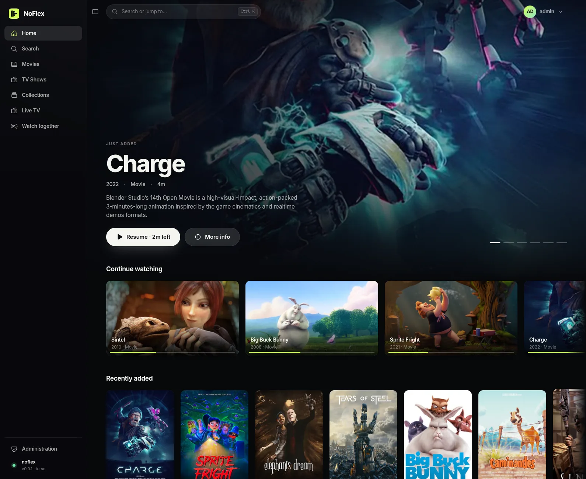
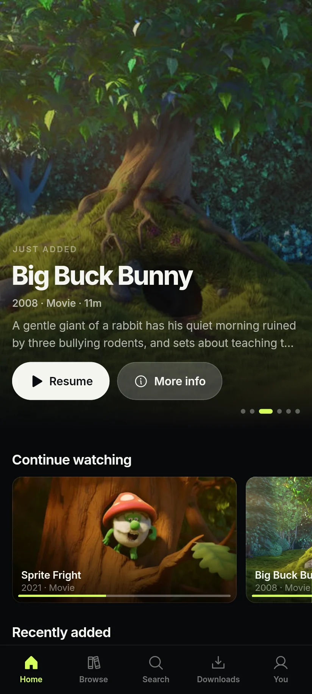

# NoFlex

_Your media, your server_ 🎬📺🎵

NoFlex is a self-hosted media server for movies, shows, music, live TV and photos, written from scratch in Rust.

**[noflex.dev](https://noflex.dev)** · [Get NoFlex](https://noflex.dev/download) · [Support](https://noflex.dev/support)

> **Status: pre-alpha.** NoFlex is under active development and not yet ready to hold your library.

<p align="center">
  
  
</p>
<p align="center"><sub>The web client, and the Flutter app at phone width. The library is <a href="https://studio.blender.org/films/">Blender Studio's open movies</a> (CC BY).</sub></p>

## Features

### Ready before you ask

- **Smart transcoding.** The server works out what each person will watch next (the next episodes, what they left unfinished, what they marked, what they'll likely pick) and prepares a version for each of their devices while it's quiet. It keeps under a CPU cap, pauses the moment anyone presses play, and stays within a storage budget.
- **Smart Downloads.** The app keeps the titles the server ranks highest within the space you give it, on Wi-Fi only if you like, and on Android and iOS finishes in the background.
- **AV1 first.** Encodes try AV1 for any device that decodes it, then HEVC, then H.264, with hardware encoding through VAAPI, NVENC, Quick Sync and AMF, and VideoToolbox and Media Foundation once the macOS and Windows servers have run on their hardware. Our own ffmpeg build brings AV1 NVENC to Nvidia drivers from 520.56.
- **No more "why is it transcoding?"** Every app shows how a title is playing, and when it transcodes, exactly why. The Flutter app measures which codecs its device decodes in hardware instead of trusting a profile.

### Better with friends

- **Linked servers.** Add a friend's server and browse, search, stream and download from it beside your own. Your app talks to each server directly; the servers never talk to each other, and nothing passes through us.
- **Watch state that follows you.** The web client carries what you've watched between servers, so what you finish on a friend's is marked watched on yours.
- **Watch together.** Open a room, share the link, and play, pause and seek in sync.

### Smart, and private

- **Search for what it's about.** Every synopsis is embedded with EmbeddingGemma on your own server, on CPU, GPU or NPU, and search blends meaning with exact words: "the one where a girl raises a dragon" finds Sintel.
- **Recommendations without a cloud,** from what you watched lately, with near-duplicates kept apart.

### Sandboxed plugins

- **Every integration is a WebAssembly plugin**, first-party ones included: TMDB, TheTVDB, MusicBrainz, OpenID Connect, Trakt, webhooks, local embeddings and intro markers.
- **Capability-gated and audit-logged.** A plugin declares what it needs up front, reaches only the hosts it names, never touches the database, and has every call logged. Plugins may use any license.

### And the rest

- **Bring your library as it is:** Plex-style folders, release names, editions from `{edition-…}` tags or names like "Director's Cut", season folders in any of a dozen languages, and one show split across 1080p and 4K season folders. Local artwork, sidecar subtitles and multi-part films are read as they are.
- **Every screen:** a web client built into the server, one Flutter app for phones, tablets, foldables and desktops, and one TV app for any TV browser, with Samsung, LG, Android TV, Fire TV, RDK and Apple TV builds awaiting real hardware. [noflex.dev](https://noflex.dev/#apps) says where each stands.
- **NoFlex Connect:** send a title to the TV and steer it from your phone, with Google Cast and AirPlay from the browser in testing.
- **Shared devices:** "Who's watching?" profiles, PINs enforced by the server, and QR-code sign-in on TVs.
- **Live TV and DVR** from M3U and XMLTV sources.
- **HDR10, HDR10+, HLG and Dolby Vision,** tone-mapped on the GPU where a screen can't show them.
- **Subtitles and audio tracks** that only transcode when they must, trickplay thumbnails, chapters, and intro skipping from chapter markers.
- **Parental controls:** allowed ratings, per-library access, and bitrate limits for each person.
- **Collections, playlists, invites,** OpenID Connect sign-in on the web (the apps and TVs sign in with a code you approve there), and API keys.
- **A status page:** live CPU, memory and network, who's streaming and why it transcodes, and what's been played.
- **Music and photos,** browsed beside your films.

## Layout & Tech Stack

**🦀 Backend: Rust.** A single Cargo workspace in `backend/` holds the server, scanner, transcoder, storage, and plugin runtime.

**🔗 API: GraphQL, code-first.** The schema is authored in Rust with `async-graphql`, and it is the only client surface: no REST layer, no compatibility shims. Subscriptions ride the same endpoint over WebSocket.

**🧩 Plugins: WebAssembly components.** Metadata and artwork providers, external login, scrobblers, notifications, and embeddings are all `.wasm` plugins running in Wasmtime, first-party ones included.

**🌐 Web: SvelteKit.** `web/` is a Svelte 5 client using Houdini for GraphQL, embedded into the server binary and served from the same origin. `site/` is [noflex.dev](https://noflex.dev), prerendered.

**📱 Apps: Flutter.** `flutter/` is one app for Android, iOS, macOS, Windows and Linux, adapting from phones to foldables to desktop windows. It plays through libmpv, preferring what each device decodes in hardware, and keeps titles offline with Smart Downloads.

**📺 TVs: SolidTV.** `solidtv/` is one app for Samsung (Tizen), LG (webOS), Android TV and Fire TV, RDK, Apple TV and any browser, driven by a remote and drawn on the GPU rather than the DOM. It plays through each device's own decoders, with native video composited under its interface.

**🗃️ Storage: Turso.** An in-process, SQLite-compatible engine by default, behind a backend-agnostic `Storage` trait.

**❄️ Nix.** One flake provides the dev shell, the packages, CI checks, and a hardened NixOS module.

## Philosophy

NoFlex takes the learnings from previous legacy projects and makes more modern choices, for better compatibility and less to maintain.

- **Complete hardware and codec support.** We want full hardware acceleration on the server and every client, whatever the platform, and we champion open codecs like AV1. Encodes try AV1 first for any device that decodes it.
- **Bring your library as it is.** NoFlex reads the most common ways of organizing a media library, with richer parsing than many other servers, Jellyfin included. Tidy layouts like `Breaking Bad (2008)/Season 01/Breaking Bad - s01e01 - Pilot.mkv` and `Inception (2010) {edition-Director's Cut}.mkv` work, and so do release names like `Inception.2010.1080p.BluRay.x264-SPARKS.mkv`, season folders like `Game of Thrones Season 1 (1080p Tigole)`, and one show's versions split across `Season 01 (1080p)` and `Season 01 (4K)`.
- **One canonical API.** Every client, ours or yours, talks GraphQL. The Rust domain type _is_ the GraphQL type, so the API never drifts from the model.
- **Extensible plugin system.** NoFlex is built to be modular. Metadata, login, scrobbling, notifications and embeddings are all plugins, sandboxed, capability-gated and audit-logged, and they can't touch the database or the network except through narrow host imports. First-party providers use the same boundary, so the plugin API is exercised on every startup. Storage is just as replaceable: Turso is the default, and another engine is a crate that passes the shared conformance suite, not a fork.
- **Cross-platform, performant frameworks.** We prefer frameworks that reach as many platforms as possible from one codebase, so a small project has less to maintain: Svelte for the web, Flutter for phones, tablets and desktops, and SolidTV for TVs.
- **First-class multi-server.** Connect to your friends' servers and browse, stream and download from them alongside your own. Your client talks to their server directly, with no middleman in between.
- **Self-hosted, end to end.** No accounts with us, no relay, no cloud inference unless you configure it. Search combines full-text with vector search over embeddings computed locally while your server is idle, and media bytes never leave your network unless you send them.

## Getting Started

Read [`docs/GETTING_STARTED.md`](docs/GETTING_STARTED.md). The short version:

```bash
nix develop
just demo up   # a throwaway server with Blender's open movies, at http://127.0.0.1:8096
just           # every other command
```

## Known Issues

- **Linux desktop: animation and scrolling can lag, especially in large or scaled windows.** This is likely in Flutter's Linux embedder rather than NoFlex. Profiling a window rendering about 2860×3128 at 2× put 39% of the main thread in `pixman`, GTK's CPU drawing, and under 2% in Dart, which matches the per-frame GTK repaint that [flutter/flutter#195287](https://github.com/flutter/flutter/pull/195287) (open) removes on Wayland. That PR builds on a newer renderer than Flutter 3.47. The parent issue, [flutter/flutter#191245](https://github.com/flutter/flutter/issues/191245), also tracks frame pacing, including the engine's fixed 60 Hz scheduling on Linux. Launching with `GDK_GL=always` or `GDK_BACKEND=x11` seems to help; the app sets neither.

## Documentation

- [noflex.dev](https://noflex.dev): what NoFlex does and where each app stands, with the [privacy policy](https://noflex.dev/privacy) and [terms](https://noflex.dev/terms).
- [`docs/GETTING_STARTED.md`](docs/GETTING_STARTED.md): build, run, and test from source.
- [`docs/CONFIGURATION.md`](docs/CONFIGURATION.md): every server setting, in TOML and environment variables.
- [`docs/DEPLOYMENT.md`](docs/DEPLOYMENT.md): NixOS, remote access, backups, hardware transcoding.
- [`docs/PACKAGING.md`](docs/PACKAGING.md): release bundles, client builds, and why we build our own ffmpeg.
- [`docs/PLUGINS.md`](docs/PLUGINS.md): the plugin model, and how to write your own.
- [`docs/PLUGIN_LICENSING.md`](docs/PLUGIN_LICENSING.md): how AGPL applies (and doesn't) to plugins.
- [`CONTRIBUTING.md`](CONTRIBUTING.md): how changes land.
- [`SECURITY.md`](SECURITY.md): reporting a vulnerability.

## Git Worktrees

Interested in having multiple checkouts or working on multiple branches at once? We support this!
Read [`docs/GIT_WORKTREES.md`](docs/GIT_WORKTREES.md).

## License

[AGPL-3.0-only](LICENSE). Contributions come in under a [Contributor License Agreement](CLA.md); [`CONTRIBUTING.md`](CONTRIBUTING.md#licensing-and-the-cla) says why. Plugins may use any license; see [`docs/PLUGIN_LICENSING.md`](docs/PLUGIN_LICENSING.md).
